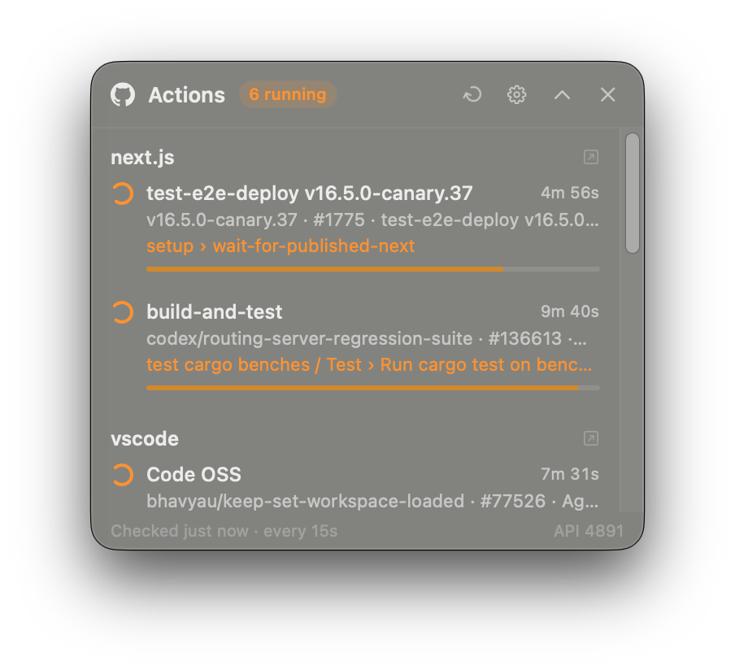

<p align="center">
  
</p>

<h1 align="center">GitHub Action Widget</h1>

<p align="center">
  GitHub Actions 실행 상황을 실시간으로 — macOS 플로팅 패널과 메뉴바 아이콘.<br>
  <a href="README.md">English</a>
</p>

<p align="center">
  
</p>

- **플로팅 패널** — 다른 앱을 쓰는 중에도 포커스를 뺏지 않고 모든 데스크톱(Space) 위에 떠 있어요.
  레포마다 실행 중인 워크플로의 *job › step*, 진행 바, 경과 시간을 보여주고, 쉬는 중이면 워크플로별 최근 결과를 보여줘요.
- **메뉴바 아이콘** — 실행 중이면 주황 점이 깜빡이고, 최근 실패가 있으면 빨간 점이 붙어요.
- **알림** — 실행이 끝나면 알려줘요 (실패만 / 시작 알림도 선택 가능). 누르면 해당 실행 페이지가 열려요.
- **API 한도를 거의 안 씀** — 조건부 요청(`ETag` / `304`)은 GitHub 시간당 5,000회 한도에 잡히지 않아서, 조용한 레포는 사실상 공짜예요.
- **로그인 화면 없음** — 이미 쓰고 있는 [GitHub CLI](https://cli.github.com) 로그인을 그대로 써요. 한국어/영어 지원.

## 설치

### AI 에이전트에게 맡기기 (Claude Code, Codex 등)

아래를 코딩 에이전트에 붙여 넣으세요.

```text
GitHub Action Widget 설치해줘: https://github.com/jundpm/github-action-widget
레포의 AGENTS.md 에 있는 "Installing for a user" 절차를 따라줘.
```

레포의 [`AGENTS.md`](AGENTS.md) 에 요구사항 확인 → 설치 → 확인 → 문제 해결 절차가 적혀 있어요.

### 한 줄 설치

```bash
curl -fsSL https://raw.githubusercontent.com/jundpm/github-action-widget/main/install.sh | bash
```

최신 릴리스를 `~/Applications` 에 설치하고, macOS 다운로드 격리 표시를 지운 뒤 실행해요. [스크립트](install.sh)는 짧으니 먼저 읽어보셔도 좋아요.

### 소스에서 빌드

```bash
git clone https://github.com/jundpm/github-action-widget.git
cd github-action-widget
./scripts/build-and-install.sh --native
```

Xcode 또는 Command Line Tools(Swift 5.10+)가 필요해요. 외부 의존성은 없어요.

### 요구사항

- macOS 14 (Sonoma) 이상, Apple Silicon / Intel
- [GitHub CLI](https://cli.github.com) 로그인: `brew install gh && gh auth login`

## 사용법

처음 실행하면 설정 창이 열려요. 볼 레포에 체크하세요 (`gh` 계정으로 볼 수 있는 레포 전부, 조직 레포 포함).

| | |
|---|---|
| 실행 줄 클릭 | GitHub 에서 해당 실행 열기 |
| 패널 헤더 ⟳ / ⚙︎ / ⌃ / ✕ | 새로고침 · 설정 · 한 줄로 접기 · 숨기기 (메뉴바에서 다시 열기) |
| 메뉴바 아이콘 | 실행 중 목록, 최근 실패, 패널 보이기/숨기기, 설정, 종료 |
| 설정 | 확인 간격(기본 15초), 알림, 항상 위에, 로그인 시 자동 실행 |

## 동작 방식

N초마다 레포별 최근 워크플로 실행을 물어보면서 직전 응답의 `ETag` 를 함께 보내요. 바뀐 게 없으면
`304 Not Modified` 가 오고 이건 한도에 안 잡혀요. 실행 중인 run 은 현재 step 을 보여주려고 job 목록도 가져와요.
레포 10개를 보면서 배포 하나가 1시간 내내 돌아도 약 480회 — 시간당 5,000회 한도보다 한참 적어요.

토큰은 실행 중에 `gh auth token` 으로 받아 메모리에만 두고, `api.github.com` 으로만 보내요.

## 삭제

```bash
pkill -x GitHubActionWidget
rm -rf ~/Applications/"GitHub Action Widget.app"
defaults delete io.github.jundpm.github-action-widget
```

## 참고

- 앱은 ad-hoc 서명이고 Apple 공증은 받지 않았어요. 설치 스크립트가 격리 표시를 지워주고, zip 을 직접 받았다면
  `xattr -dr com.apple.quarantine ~/Applications/"GitHub Action Widget.app"` 를 실행하세요.
- 이 프로젝트는 GitHub, Inc. 와 무관한 개인 비공식 프로젝트입니다. GitHub 및 GitHub 로고는 GitHub, Inc. 의 상표입니다.

## 기여하기

이슈와 PR 모두 환영해요 — [CONTRIBUTING.md](CONTRIBUTING.md) 를 참고하세요.

## 라이선스

[MIT](LICENSE)
