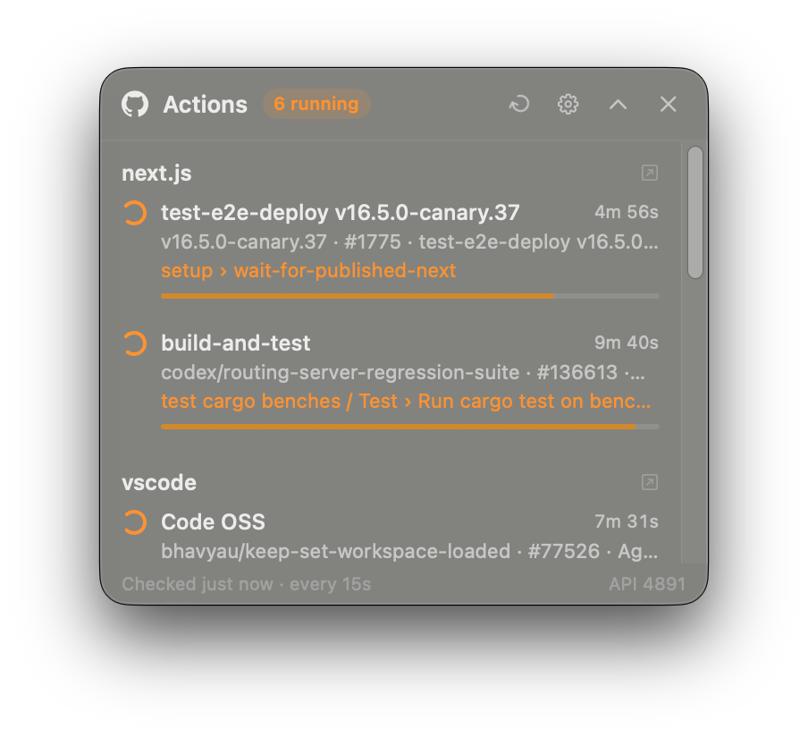

<p align="center">
  
</p>

<h1 align="center">GitHub Action Widget</h1>

<p align="center">
  Watch your GitHub Actions runs live — a floating panel and a menu bar icon for macOS.<br>
  <a href="README.ko.md">한국어</a>
</p>

<p align="center">
  
</p>

- **Floating panel** — stays on top of every app and every Space without stealing focus. Shows each repo's
  running workflows with the current *job › step*, a step progress bar and a live timer; when idle,
  the latest result per workflow.
- **Menu bar icon** — an orange badge pulses while something runs, a red badge means a recent failure.
- **Notifications** — when a run finishes (optionally failures only, or also on start). Click to open the run.
- **Cheap on your API quota** — conditional requests (`ETag` / `304`) don't count against GitHub's
  5,000 requests/hour limit, so idle repos cost almost nothing.
- **No login screen** — uses your existing [GitHub CLI](https://cli.github.com) login. Korean/English UI.

## Install

### Ask your AI agent (Claude Code, Codex, …)

Paste this into your coding agent:

```text
Install GitHub Action Widget for me: https://github.com/jundpm/github-action-widget
Follow the "Installing for a user" section of its AGENTS.md.
```

The repo's [`AGENTS.md`](AGENTS.md) tells the agent how to check prerequisites, install, verify and troubleshoot.

### One line

```bash
curl -fsSL https://raw.githubusercontent.com/jundpm/github-action-widget/main/install.sh | bash
```

Downloads the latest release into `~/Applications`, clears the download quarantine flag and launches it.
[Read the script](install.sh) first if you like — it's short.

### From source

```bash
git clone https://github.com/jundpm/github-action-widget.git
cd github-action-widget
./scripts/build-and-install.sh --native
```

Needs Xcode or the Command Line Tools (Swift 5.10+). No third-party dependencies.

### Requirements

- macOS 14 (Sonoma) or later, Apple Silicon or Intel
- [GitHub CLI](https://cli.github.com) logged in: `brew install gh && gh auth login`

## Usage

On first launch Settings opens — tick the repositories to watch (everything your `gh` account can see,
including organization repos). From then on:

| | |
|---|---|
| Click a run | opens it on GitHub |
| ⟳ / ⚙︎ / ⌃ / ✕ in the panel header | refresh · settings · collapse to one line · hide (reopen from the menu bar) |
| Menu bar icon | runs in progress, recent failures, show/hide panel, settings, quit |
| Settings | poll interval (default 15 s), notifications, keep on top, launch at login |

## How it works

Every *N* seconds it asks GitHub for each watched repo's latest workflow runs, sending the previous
response's `ETag`. Unchanged → `304 Not Modified`, which is free. For runs in progress it also fetches
the run's jobs to show the current step. Watching 10 repos while one deploy runs for an hour costs
roughly 480 requests — well under the 5,000/hour limit.

Your token comes from `gh auth token` at runtime, is held in memory only, and is sent only to `api.github.com`.

## Uninstall

```bash
pkill -x GitHubActionWidget
rm -rf ~/Applications/"GitHub Action Widget.app"
defaults delete io.github.jundpm.github-action-widget
```

## Notes

- The app is ad-hoc signed, not notarized by Apple. The installer removes the quarantine flag; if you
  download the zip manually, run `xattr -dr com.apple.quarantine ~/Applications/"GitHub Action Widget.app"`.
- This is an independent, unofficial project. It is not affiliated with, endorsed by or sponsored by GitHub, Inc.
  GitHub and the GitHub logo are trademarks of GitHub, Inc.

## License

[MIT](LICENSE)
